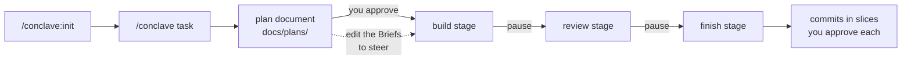

# Conclave

Conclave is a Claude Code plugin that ships a full software team as subagents: product
manager, architect, developer, challenger, reviewers, refuter, test engineer, QA, docs
writer, devops and UX. A lead sizes each task into a tier before anything runs, prints the
agent count and model mix it is about to spend, then does small work itself and dispatches
the team only when parallel builds or black-box verification earn it.

The team is project-agnostic. Everything specific to a project (components, paths, check
commands, stacks, stakes, threat model, docs, gates) lives in one profile file,
`.claude/conclave.json`, that `/conclave:init` generates. Stack knowledge (Python,
FastAPI, Django, TypeScript, React, C++, Qt 6, Qt 5, Rust, Lua, shell) ships as skills the roles load on
demand, so adding a stack is one file.

## Install

Source: https://github.com/kernelcoffee/Conclave

From GitHub, inside Claude Code:

```
/plugin marketplace add kernelcoffee/Conclave
/plugin install conclave@conclave
```

Or from the command line:

```bash
claude plugin marketplace add kernelcoffee/Conclave
claude plugin install conclave@conclave
```

### Updating

```bash
claude plugin marketplace update conclave     # fetch the new catalog
claude plugin update conclave@conclave        # install the new version
```

Restart Claude Code (or run `/reload-plugins`) to load it. An update is picked up only
when the version number changes; every release bumps it.

You do not need to run `/conclave:init` again. The profile in each project belongs to
that project and keeps working: new profile keys are optional and default to off. To see
what a new version offers, run `/conclave:init` without `--force`: on an existing profile
it validates it against the current schema, lists the keys you do not use yet, and
reports check commands or paths that no longer exist. It changes nothing.

From a local clone, for development:

```bash
git clone https://github.com/kernelcoffee/Conclave.git
claude plugin marketplace add ./Conclave
claude plugin install conclave@conclave
```

Development loop, from the project you want to try it on:

```bash
claude --plugin-dir /path/to/Conclave/plugins/conclave
```

then `/reload-plugins` after editing an agent, skill or workflow. Validate with
`claude plugin validate plugins/conclave` from the clone.

Tests, the same ones CI runs on every push and pull request:

```bash
python3 -I tests/check_repo.py                    # JSON, schema, stack packs, versions
python3 -I plugins/conclave/hooks/test_guard.py   # guardrail rules
node tests/workflows.test.mjs                     # workflow control flow, fake agents
```

## How a task runs

1. Once per project: `/conclave:init`. Review the generated `.claude/conclave.json`, fill
   the `TODO` values (stakes, threat model, pitfalls), fix any command it could not verify.
2. `/conclave <task>`. The lead prints a triage line such as
   `Tier T2 · backend · ~9 agents · opus×7 sonnet×2 · pace step · build → review → finish`
   and writes a plan document to `docs/plans/<date>-<slug>.md`. The document leads with
   the functional spec (why, goals, non-goals, acceptance criteria, the decisions only
   you can make, each option with its consequence) and follows with the technical spec
   (current state, proposed model, alternatives, migration, risks, briefs per component,
   contracts, expected failures). Nothing is built yet.
3. You approve the plan. Nothing is built until you approve the plan document, at any
   pace; the functional spec is what you approve, and the technical spec serves it. Edit
   the document instead of replying if you prefer; the lead re-reads it. A redesign or a
   new feature with an open shape gets `--design`: a design study proposes the model and
   argues the alternatives before the spec is written.
4. One stage at a time. With the default pace, the lead pauses after each of build,
   review and finish with a short summary of what changed and what was caught, and the
   document updated. You say go, or edit the Briefs section first: the next stage builds
   from what the document says. `--pace plan` and `--pace auto` run the three stages
   through after the approval, pausing only on decisions. A T1 task gets a short plan and
   the same approval before the change; T0 has none.
5. A session can end between stages. `/conclave:continue` (or `/conclave` with no task)
   resumes at the next stage from the document and the run state in `.claude/conclave/`.
6. When the finish stage reports `ready_to_commit`, the lead proposes commits in the
   build-safe slices the dev declared, the plan document in the first one. Nothing is
   committed until you approve, and the guardrails ask you for every commit.



Nothing to the right of the plan document runs before you approve it; every later arrow
is a pause you release.

Add `--dry-run` to see the triage and the plan without spending anything, `--tier N` to
force a tier, `--design` to force the design study.

## Tiers

| Tier | When | What runs | Agents |
|---|---|---|---|
| T0 | No behaviour change: typo, comment, wording, config value, question | Lead inline | 0 |
| T1 | One component, at most 3 files, existing patterns, no new public surface, clear spec | Lead implements, one correctness reviewer, lead fixes | 1 |
| T2 | One component, new behaviour or more files, tests needed, spec clear | `dev-team`: build, challenge (1 round), review (correctness, security, stack), verify, tests, QA | about 8 to 12 |
| T3 | Two or more components or a contract, a risky path, an unclear spec, or `--tier 3` | Full pipeline: pm, architect, consult, build in parallel, cross-check, challenge (2 rounds), all lenses, verify (3 votes on high), fix, tests, docs, QA | 20 or more |

A path listed in `tier_overrides.risky_paths` raises any task to at least T2;
`tier_overrides.min_tier` sets a floor.

## T3 options

Off by default; each one is a flag on `/conclave` or a profile setting.

- `--contract` (`exec.contract`): the test engineer writes the contract tests from the
  architect's failure matrix before any code exists, each with its declared expected
  failure; the test-auditor confirms every test fails exactly as declared, the verifier
  freezes them by checksum, and the devs may not edit them. Costs the auditor pass and a
  verifier call; set `tier_overrides.contract_by_default` to make it the T3 default.
- `--duel` (`exec.design = "duel"`): two devs with the specialities the architect names
  propose a design, critique each other, and the architect judges or merges. About five
  extra agents; `tier_overrides.design_duel_by_default` makes it the T3 default.
- `gates.mutation_probes` (profile): after the build passes, the test-auditor sabotages
  the implementation once per contract test, requires the test to fail, restores the file
  and proves it by checksum. Catches tests that pass for the wrong reason; one rebuild per
  probe, so costly on compiled stacks.

## Roles

| Agent | What it does | Default model |
|---|---|---|
| `lead` | Triage, tier, model choice, inline work at T0/T1, launches workflows, proposes the commit | session |
| `pm` | Spec, goals, acceptance criteria, components touched, decisions only the user can make | session |
| `architect` | Per-component briefs, contracts, expected-failure matrix, ad-hoc specialists | session |
| `dev` | Builds one component from its brief, writes tests, runs the checks | opus |
| `challenger` | Same-stack adversary: re-derives the change, writes failing proof tests, escalates weak rebuttals | opus |
| `reviewer-correctness` | Real bugs with a concrete failure scenario | opus |
| `reviewer-security` | Threat-model driven review; also the `/conclave:audit` sweeper | opus |
| `reviewer-conventions` | Project rules from the profile and CLAUDE.md, maintainability, scope | sonnet |
| `reviewer-stack` | Language and framework lens; loads the stack pack named in its task | opus |
| `ux` | User-facing review of `ui` components; consultant before the build | opus |
| `refuter` | Tries to refute each finding; only what survives reaches the devs | opus |
| `test-engineer` | Black-box tests from the failure matrix, written before reading the implementation | opus |
| `qa` | Checks, build, e2e, coverage gate, shortcut audit, flake runs | sonnet |
| `docs-writer` | Keeps the docs the profile names in step with the change | sonnet |
| `devops` | CI, containers, packaging, version bumps, release | opus |
| `verifier` | Runs gate commands (scope, freeze, checks) and reports exit codes and output verbatim; never fixes | sonnet |
| `test-auditor` | Audits contract tests fail exactly as declared and are not tautologies; runs mutation probes | opus |

Override by role or group (`planners`, `workers`, `reviewers`, `mechanical`, `refuter`) in
the profile's `models` block. No subagent ever commits.

## Commands

| Command | Does |
|---|---|
| `/conclave <task> [--tier N] [--rounds N] [--pace step\|plan\|auto] [--contract] [--duel] [--dry-run]` | Triage, write the plan document, run the task one stage at a time |
| `/conclave:continue [slug]` | Resume a task at its next stage, from its plan document and run state |
| `/conclave:init [--force]` | Generate `.claude/conclave.json` |
| `/conclave:plan [--design] <task>` | Write the plan document only: functional spec, then technical spec; `--design` runs a design study (current state, proposed model, alternatives, decisions) first; no code |
| `/conclave:review [base-ref] [--lenses a,b,c]` | Review and refute the working-tree diff; changes nothing |
| `/conclave:release <version>` | devops bumps versions, drafts the changelog, checks CI, proposes commit and tag |
| `/conclave:audit [path]` | Whole-repo security sweep, one reviewer per component, refuters on high findings |

Workflows (`/conclave:dev-team`, `/conclave:review-team`, `/conclave:plan-team`) can also be
launched directly, with `args: { profile, exec }` or with a plain task string; see
`docs/design.md` for `exec`.

## Guardrails

The plugin ships hooks the harness runs on every tool call, in the main session and in
every subagent. They block outright (or, for `commit-approval` and, from the main session, `pii`, ask first), with the rule name and the reason, and never
echo a matched value. Overrides come only from the environment Claude Code was started
with (`CONCLAVE_ALLOW=rule,rule`, `CONCLAVE_ALLOWED_HOSTS=host,host`,
`CONCLAVE_PII_ALLOW=value,value`); an inline
`CONCLAVE_*=` assignment on a command is itself denied.

| Rule | Blocks |
|---|---|
| `read-secret-file` | Read, Grep, Glob, Edit, Write and shell access to `.env*`, keys, certificates, credential files, `~/.ssh`, `~/.aws`, `~/.config/gh` and the like (`.env.sample` and friends stay allowed); a heredoc body that `cat`, `tee`, `git commit -F -` or `gh --body-file -` takes as text is not read for filenames unless it is unquoted and holds a `$` or backtick, and a redirect target after it is still a path |
| `write-secret` | Write/Edit content or a shell command carrying a private key, cloud, GitHub, Slack, Stripe, OpenAI/Anthropic, JWT or connection-string credential, or a real-looking `password=`/`token=` literal (a quoted value, or a bare one that is not an expression); a key name or a code expression alone never matches |
| `commit-secret` | `git add` or `git commit` with a secret file or secret content staged |
| `send-data-out` | request bodies, uploads, pipes into `curl`/`wget`, `scp`/`rsync`/`nc` to hosts outside localhost, private ranges and `CONCLAVE_ALLOWED_HOSTS`; any request carrying a literal credential (curl arguments and WebFetch URLs are read as outbound text: only a call, member path, index, environment lookup or placeholder passes) |
| `subagent-no-git` | `git commit`, `push` or `tag` from a subagent |
| `protect-history` | push to the default branch, force or delete pushes, `reset --hard`, amend or rebase of pushed commits, `branch -D`, reflog or gc pruning |
| `destructive-command` | `rm -r` outside the project or on its root, `sudo`, `git clean -f`, wholesale `checkout --`/`restore .`, `stash drop`, `git config --global`, global package installs, writes to home config or system directories, piping downloads into a shell |
| `stay-in-project` | Write/Edit or a writing shell command outside the project directory (temp dirs, the scratchpad and `~/.claude` are allowed) |
| `no-secret-in-output` | a subagent hand-back or a final message that contains a secret-looking value; the author is sent back to rewrite it (inline code spans and unlabelled or language-labelled fences count as source, so illustrative code passes; see below) |
| `commit-approval` | nothing is blocked: `git commit`, `push`, `tag` and publishing `gh` commands (pr, issue, release, gist) from the main session always raise a permission prompt, even in auto mode; set `CONCLAVE_ALLOW=commit-approval` when you want the session to commit on its own |
| `pii` | personal or identifiable information in written files, staged changes, commit messages, `gh` text or data sent out: email addresses, phone numbers, home-directory paths naming a user, card, IBAN or national id numbers, and this machine's own git name, git email and home path. Placeholders (`user@example.com`, `/home/user`, `noreply` addresses) pass; `LICENSE`, `AUTHORS`, `CODEOWNERS` and similar files are exempt, and so are the author, maintainer, contributor and owner fields of `plugin.json`, `marketplace.json`, `package.json`, `pyproject.toml` and `Cargo.toml` (an email or the git identity there is a public contact; any other personal data in those files still blocks); a public contact goes in `CONCLAVE_PII_ALLOW`. The main session gets a permission prompt naming the kind and location (never the value), so you confirm the change is intended; a subagent is denied, as it cannot carry the prompt; if the same call also breaks a deny rule, the deny wins |

A secret is a literal value, never a key name or a code expression. Known-prefix tokens
match anywhere; a bare value after a credential key (`password`, `token`, `api_key`,
`secret`, ...) that looks real is a secret unless it is an expression: a call, member
path, index, environment lookup or template placeholder, or, in the code of a source
file, a plain identifier. What the text is decides this, not its shape: source is a file
with a programming-language extension or interpreter shebang; config is `.env`, `.ini`,
`.toml`, `.yaml`, `.json`, shell scripts, Dockerfiles and the like, where only
environment lookups and placeholders pass; the words of a shell command are data, and
curl arguments and WebFetch URLs are outbound, where the same expressions pass but a
plain identifier does not; everything else (prose, `.md`, `.txt`, tool output) is free
text. A key inside a string, docstring, template literal, raw string or comment of a
source file is read like a shell command word: only expressions and placeholders pass.
Outside source text a member path or call whose names look random (`sk.<base64>.<base64>`,
`<random>(prod)`) is a literal, not an expression, and a comparison or arithmetic
operator after a value does not make it one anywhere. In free and config text a value
may sit on the next line, unindented or as the first word of the line, and `=>` counts
as a separator. In a final message inline code spans and fences that are unlabelled or
labelled with a programming language are source; `hcl`, `terraform`, `nginx`, `apache`,
`ssh-config`, `xml`, `csv`, `http`, `properties`, `dockerfile`, `ini`, `yaml`, `json`,
`env`, `toml` and the like are config; `sh`, `bash` or `console` are data; `text`, `log`,
`output`, `diff`, `patch` and any label not known are free, and a fence left open is free
to the end of the message. A secret is always denied, redacted or refused, never asked
about.

Tool results from Bash, Read and Grep are scanned too: secret-looking values are
replaced with `[REDACTED <kind>]` before the model sees them. This is a tripwire against
mistakes, not a security boundary: a command can always be written in a way the parser
does not recognise. Test the rules offline with
`python3 -I plugins/conclave/hooks/test_guard.py`.

## The profile

`.claude/conclave.json` describes the project: `pace` (how often a task pauses), `components` (each with `paths`, `tests`,
`stacks`, `checks`, optional `build`, `e2e`, `coverage`, `setup`, `pitfalls`,
`conventions`, `ui`), `contracts` between components, `stakes` (what severity `high`
means here), `security.threat_model`, `docs` (including `docs.plans`, where plan documents go), `devops`, `gates`, `git`, `models` and
`tier_overrides`. Start from `plugins/conclave/templates/conclave.json`; the schema is
`plugins/conclave/schemas/conclave.schema.json`. Findings are routed to the dev that owns
the path, the docs writer, or devops by matching these entries. The same entries drive
`bin/scope-check.sh` and `bin/freeze.sh`, which the verifier runs so that path ownership
and frozen contract tests are enforced mechanically, not by prose.

## Stack packs

| Pack | Covers |
|---|---|
| `stack-python` | Typing, asyncio, exceptions, resources, pytest, ruff, mypy, pytest-cov |
| `stack-fastapi` | Routers, dependencies, sessions and transactions, schemas, WebSockets, schedulers |
| `stack-django` | Models and queries, migrations, forms and serializers, templates, auth and permissions, async views, tasks, pytest-django |
| `stack-typescript` | Strictness, narrowing, async, API type fidelity, vitest, tsc, eslint |
| `stack-react` | Hooks and effects, queries, state, rendering, forms, theme and layout, Playwright |
| `stack-cpp` | Standard modern C++: const and initialisation discipline, ownership and RAII, strong types, warnings as errors, sanitizers, clang-tidy, ctest |
| `stack-qt6` | Qt 6 on its own terms: object tree, signals and slots, threads and event loops, QML/C++ boundary, Qt SQL, Qt Test, clazy, qmllint |
| `stack-qt5` | Legacy Qt 5.15: what still applies, what is deprecated or missing, forward compatibility, qmake |
| `stack-rust` | Edition 2024 rules, ownership, error handling, async, unsafe, cargo clippy, cargo test, llvm-cov |
| `stack-lua` | Addon and script idioms, globals, event handlers, busted |
| `stack-shell` | bash strict mode, quoting, portability, shellcheck, bats |
| `stack-generic` | Fallback checklist for stacks without a pack |

One more pack, `writing-docs`, is not a stack: it tells the docs writer and the lead how
to structure a document and when a Mermaid diagram earns its place.

Adding a stack:

1. Add `plugins/conclave/skills/stack-<name>/SKILL.md` with the sections Idioms, Review
   checklist, Testing, Tooling, Pitfalls.
2. Add `<name>` to the `stacks` enum in `plugins/conclave/schemas/conclave.schema.json`.
3. Add a row to the table above.

## Migrating a project with the legacy team

Projects that carry their own `.claude/agents/*.md` and `.claude/workflows/dev-team.js`
get the same pipeline from the plugin. Run
`/conclave:init`, compare the generated profile with the project's CLAUDE.md commands,
move project-specific lines from the old agent files into the profile's `pitfalls`,
`conventions`, `stakes` and `security.threat_model`, then delete the local agents and
workflow and point the "Agent team" section of CLAUDE.md at `/conclave`. The gate scripts
`scripts/check-coverage.sh` and `scripts/shortcut-audit.sh` are replaced by the plugin's
`bin/diff-coverage.sh` and `bin/shortcut-audit.sh`, driven by the profile's `coverage` and
`gates` entries, and `bin/scope-check.sh` and `bin/freeze.sh` take over any local scope or
checksum gates.

## Design

`docs/design.md` is the contract between the pieces: principles, tiers, model policy, the
`exec` object, what every subagent prompt contains, return shapes, file ownership, agent
file conventions and the stack pack format.
