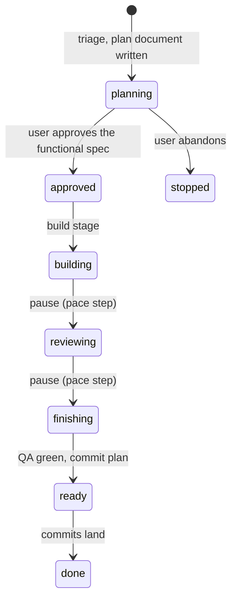

# Conclave design

Conclave is a Claude Code plugin that ships a full software team as subagents, plus a lead
that decides how much of that team a task deserves. This file is the contract between the
pieces; agent files, skills and workflow scripts all follow it.

## Principles

1. **One main loop holds the context.** The lead (the session itself) triages, plans, and
   does small work directly. Subagents are spawned only for parallel builds, black-box
   verification, and work that would bloat the main context. Every handoff loses detail,
   so there are as few as the tier allows.
2. **Tier before tokens.** The lead prints the tier, the agent count and the model mix
   before anything is dispatched. The workflow script never decides its own shape; it
   executes the `exec` object the lead hands it.
3. **Generic roles, project profile.** Agent bodies contain no project names, paths or
   commands. Everything project-specific lives in `.claude/conclave.json` and in stack
   packs (`skills/stack-*`).
4. **Nobody commits but the user.** Subagents never run `git commit`. The lead proposes a
   commit message and waits for approval.
5. **Plan first, functional over technical.** Every task at T1 and above is written down
   in a plan document whose functional spec (why, goals, non-goals, acceptance, decisions)
   comes first and is what the user approves; the technical spec (current state, proposed
   model, alternatives, briefs, contracts, failure matrix) serves it. Nothing is built
   before the approval, at any pace. A brief, a design or a finding that traces to no goal
   or acceptance criterion is out of scope.

## Tiers

| Tier | When | Runs |
|---|---|---|
| T0 | no behaviour change: typo, comment, wording, config value, question | lead inline |
| T1 | one component, at most 3 files, existing patterns, no new public surface, clear spec | lead implements inline, one `reviewer-correctness` pass, lead fixes |
| T2 | one component, new behaviour or public surface or more files, tests needed, spec clear | `dev-team` workflow: build, challenge (1 round), review (core lenses + stack), verify (1 vote), tests, qa |
| T3 | two or more components or a contract pair, a risky path, an unclear spec, or the user asks | `dev-team` workflow, full: pm, architect, consult, build, cross-check, challenge (2 rounds), all lenses + ux, verify (3 votes on high), fix, tests, docs, qa |

Bumps: `profile.tier_overrides.min_tier`; any touched path in
`profile.tier_overrides.risky_paths` raises to at least T2; `--tier N` from the user wins.

T3 options (off by default; the lead turns them on when earned, the user with a flag, or
the profile with `tier_overrides.contract_by_default` / `design_duel_by_default`):

| Option | Mechanism | Cost |
|---|---|---|
| `exec.contract` | Test-first: the test engineer writes failing tests with a declared expected failure each; the test auditor confirms every one fails exactly as declared and is not a tautology; the verifier freezes them with `bin/freeze.sh`; devs may not edit them and the verifier checks after every write phase | about 3 agents |
| `exec.design: "duel"` | Two devs with specialities named by the architect each design, then critique the other; the architect judges disagreements or declares them undecidable (a human decision) | 4 or 5 agents |
| `profile.gates.mutation_probes` | After review is clean, the test auditor sabotages the implementation once per test and requires the test to fail, restoring the tree and proving it by checksum; the test engineer repairs tests that survived, once | 1 to 3 agents, plus a rebuild per probe on compiled stacks |

Always on at T2 and above: the `verifier` (sonnet, low effort) runs `bin/scope-check.sh`
after Build, after each Fix round and after test-engineer bug fixes. Out-of-scope files go
back to their owner once; QA runs the same gate at the end. The docs phase ends with a
second `docs-writer` call in audit mode and a fix pass when it reports corrections.

## Model and effort policy

| Group | Roles | Default model | Effort |
|---|---|---|---|
| planners | lead, pm, architect | inherit (session model) | high |
| refuter | refuter | opus (session model for `high` at T3) | high |
| workers | dev, challenger, test-engineer, devops | opus | high |
| reviewers | reviewer-correctness, reviewer-security, reviewer-stack, ux, test-auditor | opus | high |
| mechanical | reviewer-conventions, docs-writer, qa, verifier, profile reader | sonnet | medium (qa, verifier and profile reader: low) |

Override order: `exec.models[role]` > `exec.models[group]` > `profile.models[role]` >
`profile.models[group]` > defaults. `inherit` means no model option is passed.

## Interfaces

### Profile (`.claude/conclave.json`)

See `plugins/conclave/schemas/conclave.schema.json`. Key fields the scripts rely on:
`name`, `base`, `components[]` (`name`, `paths`, `tests`, `stacks`, `ui`, `checks`,
`build`, `e2e`, `coverage`, `setup`, `pitfalls`, `conventions`), `contracts`, `stakes`,
`security`, `docs`, `devops`, `gates`, `git`, `models`, `tier_overrides`.

### Execution plan (`exec`, built by the lead, consumed by `workflows/dev-team.js`)

```js
{
  tier: 2,                       // 2 or 3; the lead handles 0 and 1 itself
  task: "the user's request, verbatim plus any clarifications",
  brief: "",                     // T2: the lead's own brief (pm and architect are skipped); T3: empty
  components: ["backend"],       // component names the task touches (the architect may extend at T3)
  rounds: 1,                     // challenge and review rounds
  lenses: ["correctness", "security", "stack"],   // plus "conventions", "ux" when earned
  refute_votes_high: 1,          // 3 at T3
  skip: [],                      // any of pm, architect, consult, crosscheck, challenge, tests, docs, qa
  models: {}, effort: {},        // per-role or per-group overrides
  base: "origin/main",
  contract: false,               // T3 option: test-first contract tests, audited and frozen
  design: "",                    // T3 option: "duel"
  dev_specialities: [],          // optional override of the architect's duel specialities
  decisions: "", proceed: false, // resume after a needs-human stop
  briefs_from_files: false,      // force agents to read their brief from the plugin agents dir
  plugin_root: "/abs/path/plugins/conclave",
  stage: "all",                  // "plan" | "build" | "review" | "finish" | "all"; one stage per launch
  state: null,                   // the state object the previous stage returned, passed back verbatim
  mode: "",                      // "design": a design study runs before the pm in the plan stage
  // pace ("step" | "plan" | "auto") is the lead's own setting; the script never reads it
}
```

Workflow args: `{ profile, exec }`, or a plain string, which the script treats as
`exec.task` with every other field at its default. When `profile` is missing the script
spends one low-effort agent to read `.claude/conclave.json`. The workflows are named
`conclave:dev-team`, `conclave:plan-team` and `conclave:review-team`, so that none
collides with the `plan`, `review` and `conclave` skills that drive them.

### Design mode and decisions

`exec.mode: "design"` (plan stage of `dev-team`, and `plan-team`) runs the architect as a
design study before the pm. It returns `current_state` (how it works today, with file
references), `problems`, `proposed_model` (prose), `alternatives` (`name`, `summary`,
`pros`, `cons`), `decisions`, `migration` and `risks`. When `decisions` is non-empty and
`exec.proceed` is not set, the run stops with `status: "needs-human"` and
`decision_request: { question: "Design decisions", context: { decisions, proposed_model,
alternatives } }`; it resumes with `exec.decisions` and `exec.proceed: true` (and the
saved `state` in `dev-team`). The pm then specs against the chosen model and the architect
plans with the study as context. Returns carry `design_study`.

Every decision item, from the design study, the pm or the architect, is
`{ question, options: [{ label, consequence }], recommendation }`, recommendation first;
a plain string option is accepted but carries no consequence. The lead presents each
option with its consequence and writes `Chosen:` into the plan document.

### The approval gate

The build stage is never launched, at any pace, until the user has approved the plan
document. The lead writes the Functional and Technical specs (itself at T1 and T2, from
the plan stage at T3), shows the Functional spec, and waits. Status moves `planning` →
`approved` on the user's word → `building` on launch. Pace governs only the pauses after
build, review and finish.

### What a workflow returns

Every workflow returns a `status`:

- `needs-human`: stopped in `phase` with `decision_request: { question, context }`. Any
  phase can stop: pm or architect decisions, a frozen test modified after the freeze, a
  tree the test auditor could not prove restored, an undecidable design duel, exhausted
  review rounds with open findings, a role that returned nothing. The lead handles every
  one the same way: ask the user, relaunch with `exec.decisions`, `exec.proceed: true`
  and `skip` narrowed to the phases already passed.
- `accepted`: review clean and QA green (`ready_to_commit: true`), with `commit_plan`:
  ordered build-safe slices (`title`, `files`, `rationale`) that the lead proposes as
  separate commits: frozen contract tests first, each dev's slices, test additions, docs.
- `not-ready`: finished but a gate is red; `qa` says which.

## Stages, pace and the plan document

The dev-team script runs one stage per launch and returns everything the next stage
needs, so the lead can pause between stages and the user can read, edit and resume.

| Stage | Runs | Produces |
|---|---|---|
| `plan` | design study (`exec.mode: "design"`), pm, architect, design duel, consult | `state.briefs` (final), spec, contracts, expected failures |
| `build` | contract tests, build, cross-check, challenge | files changed, challenges, escalations |
| `review` | lenses, refute, fix, probes | findings raw, confirmed, fixed, probe results |
| `finish` | tests, docs, QA | `accepted` or `not-ready`, `commit_plan` |

Return contract of every launch: `status` (`stage-done`, `needs-human`, `accepted`,
`not-ready`), `stage`, `next_stage` (`build`, `review`, `finish` or `null`), `state`
(opaque to the lead except `state.briefs`, passed back verbatim), `summary` (components,
files_changed, challenges, escalations, findings_raw, findings_confirmed,
findings_fixed, probes, tests_added, docs_files, qa_green, agents_used), `agents`, and
for `needs-human` the `decision_request`; a stop is resumed by relaunching the same
stage with `exec.decisions`, `exec.proceed: true` and the same `state`. `stage: "all"`
runs every stage in one launch. At T2 the lead never launches `plan`: it writes the brief
itself and launches `build` with `exec.brief` and no `state`.

The plan document lives at `<docs.plans>/<YYYY-MM-DD>-<slug>.md` (default
`docs/plans/`), created by the lead from `templates/plan.md` right after triage at T1 and
above, kept current after every stage, and committed in the first commit slice. It is
the user's steering surface: before `build` the lead re-reads its Briefs section into
`state.briefs`, so an edited brief wins over the architect's. Stage state for resuming
lives in `.claude/conclave/runs/<slug>.json` (ignored by git): `task`, `slug`,
`plan_doc`, `tier`, `exec`, `stage_done`, `state`, timestamps. `/conclave:continue`
reads both and launches the next stage, in this session or a later one.

Pace is the lead's setting, from `--pace` on the command, else `profile.pace`, else
`step`: `step` pauses after every stage, `plan` only after the plan, `auto` launches
`stage: "all"` and pauses only on decisions. T1 always pauses once, after the brief is
written and before any code; T0 has no plan document.

### What every subagent prompt contains

The script builds a context block and prepends it to each role's task:

```
Project: <name>. <summary>
Base ref: <base>
Stakes (severity high means): <stakes>
Threat model: <security.threat_model>

Task:
<task>

Component(s) you work on:
<JSON of the relevant component entries: paths, tests, stacks, checks, pitfalls, conventions>

Stack packs: load each with the Skill tool before you start: conclave:stack-python, ...

Contract(s):
<text or "(none)">

Expected failures:
- behaviour | input or state | expected outcome
```

Agents may also read `.claude/conclave.json` themselves. CLAUDE.md is injected by Claude
Code; prompts never paste it.

### Return shapes

Enforced by JSON schema in the script: `SPEC` (pm), `PLAN` (architect, plus
`dev_specialities`), `DESIGN`, `CRITIQUE`, `JUDGEMENT_DESIGN` (duel), `DEV` (plus
`commit_plan`), `CROSSCHECK`, `CHALLENGE`, `FINDINGS`, `VERDICT`, `RECHECK`, `TESTS`
(plus `test_files`, `contract_tests`, `could_not_reproduce`), `RED_AUDIT` and `PROBES`
(test-auditor), `VERIFY` (verifier: `runs` of `{command, exit_code, output_tail}` and
`all_passed`), `DOCS`, `DOC_AUDIT`, `QA`. Every finding carries `file`, `line`,
`severity` (`high`/`medium`/`low`), `summary`, `failure_scenario`. Severity `high` is
defined by `profile.stakes`.

### Mechanical gates (`bin/`)

Generic scripts any project can run; QA and the verifier call them with arguments from
the profile, never from a project script:

| Script | Does |
|---|---|
| `scope-check.sh <base> <prefix-or-glob>...` | lists changed or untracked files outside the given paths; exit 1 if any |
| `freeze.sh freeze <file>...` / `freeze.sh verify` | prints sha256 lines; verifies them from stdin; exit 1 on any change |
| `shortcut-audit.sh <base> --scope … --tests …` | suppressions, weakened tests, swallowed errors, debt markers, removed assertions, test-count drop |
| `diff-coverage.sh <report> <base> <min> [--src-root] [--include …]` | diff-cover on a component's coverage report |

A project may list its own gate script in a component's `checks` or in `gates.extra`;
Conclave never depends on one.

### File ownership

`ownerOf(file)` in the script: first component whose `paths` match (prefix when the entry
ends with `/`, glob otherwise), else `docs-writer` for `docs.paths`, else `devops` for
`devops.paths`, else the first component in `exec.components`.

## Agent file conventions

- Frontmatter: `name`, `description` (one or two sentences, says when to use it),
  `model`, `effort`, `tools`. Read-only roles list `Read, Grep, Glob, Bash` and say in
  prose that Bash is for `git diff`, `git status` and read-only commands. Plugin agents
  cannot set `permissionMode`; write limits are stated in prose and routed by the script.
- Body order: opening paragraph (who you are, what you may edit), `## Stance` for
  adversarial roles, the role-specific method section, `## Shortcut checklist` for anyone
  who judges code, `## Checks before you report`, `## What you return`.
- No project names, paths, commands or framework names in the body. Say "the component's
  `checks`", "the stack packs named in your task", "`profile.stakes`".
- Final message is data for the orchestrator, never a human-facing summary.

## Documentation presentation (`skills/writing-docs/SKILL.md`)

The docs-writer and the lead load one pack that says how each kind of document is
structured, when a table or a code block beats prose, when a diagram earns its place, and
the Mermaid patterns to use (flowchart, sequenceDiagram, stateDiagram-v2, erDiagram) with
the syntax that bites. A design study may return `diagrams` (title, kind, mermaid); the
lead places them in the plan document's Current state and Proposed model sections. In
audit mode a stale diagram is a finding like a stale sentence. The stages, drawn the way
the pack asks:



## Stack packs (`skills/stack-<name>/SKILL.md`)

One per stack listed in the schema enum. Sections: `## Idioms` (what good code looks
like), `## Review checklist` (what reviewers and challengers look for), `## Testing` (how
tests are written and run, fixtures, what counts as proof), `## Tooling` (lint, type
check, build, coverage report commands and their usual flags), `## Pitfalls` (what this
stack gets wrong under pressure). Packs are loaded by `dev`, `challenger`,
`reviewer-stack`, `test-engineer` and the lead at T0/T1.

## Guardrails (`hooks/`)

`hooks/hooks.json` registers `hooks/guard.py` on PreToolUse (Bash, Read, Grep, Glob,
Write, Edit, WebFetch), PostToolUse (Bash, Read, Grep), SubagentStop and Stop. A
PreToolUse deny is exit code 2 with the reason on stderr: `Conclave guardrail [rule]:
detail`. PostToolUse returns `updatedToolOutput` with secret-looking values redacted.
Stop and SubagentStop return `decision: block` once (never when `stop_hook_active`).

Facts the design rests on: a plugin cannot ship permission rules, so hooks are the only
enforcement it has; plugin hooks fire inside subagents with `agent_id` and `agent_type`
set, which is how `subagent-no-git` tells a subagent from the main session; no hook sees
assistant text before it is shown, so the output rule works on hand-backs and final
messages, not on streaming text. Bash rules parse the command text (pipes, `&&`,
`sh -c`, `git -C`), which is a tripwire, not a boundary.

Secret rules match a literal value, never a key name or a code expression. Known-prefix
tokens match anywhere; a bare value after a credential key is a secret unless it is
syntactically an expression (call, member path, index, environment lookup, template
placeholder) or, in the code of a source file, a plain identifier. The text kind comes
from where the text comes from, never its shape (`TextKind` in `guard.py`): source
(language extension or interpreter shebang), config (env, ini, toml, yaml, json, shell,
Dockerfile, systemd: lookups and placeholders only), data (the words of a Bash command),
outbound (curl arguments, WebFetch URLs) and free (prose, documents, tool output). A key
inside a string, docstring, template literal, raw string or comment of a source file
(`source_inert_spans`) is data: only expressions and placeholders pass. Outside source
text a member path or call with a random-looking name (`random_name`) is a literal, an
operator after a value never makes it an expression, and in free and config text a value
may sit on the next line (`loose_value`) and `=>` separates key and value. In a final
message inline code and unlabelled or programming-language fences are source (`fence_kind`),
fences labelled with a config or shell format take that kind (`hcl`, `nginx`, `xml`,
`http`, `properties` and `dockerfile` among them), and `text`/`log`/`output`, `diff`,
`patch` and unknown labels are free, as is a fence left open to the end. Secrets always
deny, redact or refuse; they are never asked about.

Two rules ask instead of denying. `commit-approval` returns `permissionDecision: ask` for
commit, push, tag and publishing `gh` commands from the main session, collected during
the checks and emitted only when no other rule denied the same call; in a headless run
the ask resolves to not approved. `pii` guards personal or identifiable values in what
is written, staged, committed, published or sent, never in what is read or shown to the
user in the session: from the main session a hit asks, naming the kind and location but
not the value, so the developer confirms the change is intended; from a subagent
(`agent_id` set, which cannot carry the prompt) it denies, as `subagent-no-git` does.

Rules and overrides are documented in the README; the rule names are stable because
`CONCLAVE_ALLOW` refers to them. Adding a rule: a `check_*` function in `guard.py`, a
`deny("<rule>", ...)` call with a reason that never contains the matched value, cases
in `test_guard.py`, a README row.

## Adding a stack

1. Add `skills/stack-<name>/SKILL.md` with the five sections.
2. Add `<name>` to the `stacks` enum in `schemas/conclave.schema.json`.
3. Add a line to the README table. No agent or script changes.
