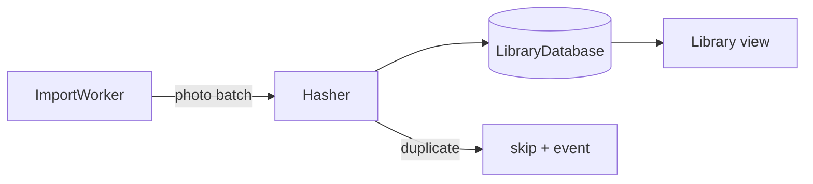
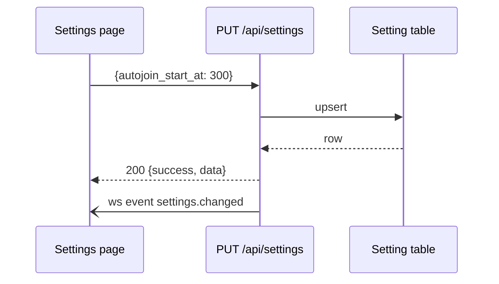
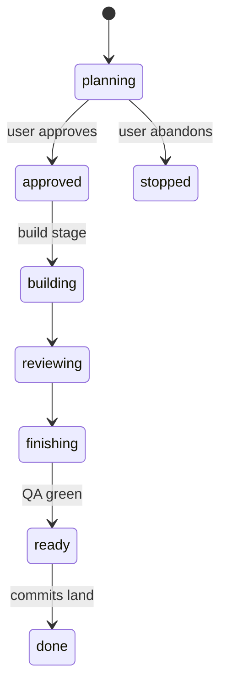
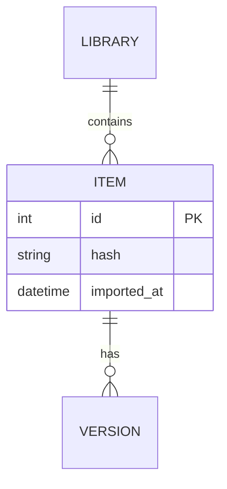

# Writing documentation

A document is for a reader who was not there: a contributor who never spoke to the
author, or the user approving a plan. Everything below serves that reader. Truth to the
code comes first; presentation is what makes the truth findable.

## Structure

- Lead with what the reader needs to decide or do; background comes after. The first
  paragraph of any document or section answers "what is this and why does it matter".
- One idea per paragraph, three to six sentences. A section longer than a screen gets a
  subsection or a table.
- Headings are nouns naming the content ("Import pipeline", "Settings keys"), not
  questions or process narration ("What we did").
- Name real things: file paths, functions, endpoints, settings keys, defaults, exit codes.
  A claim a reader can check against the code is worth three that sound right.
- No marketing, no diff summaries, no "round 3" or ticket numbers in a document that
  describes the system; the log of how a change was made belongs in the plan document's
  Log, not in the architecture doc.
- Keep the document's existing structure and tone when editing it; add presentation to
  the sections you touch, do not reformat sections the change did not reach.

## When to use what

| Use | For |
|---|---|
| Prose | the "why", trade-offs, anything with nuance |
| Bullet list | three or more parallel items that are each one or two sentences |
| Numbered list | steps that happen in order |
| Table | comparisons, options with consequences, fields and their meaning, commands and what they do, anything a reader scans by row |
| Code block | commands, paths, config snippets, request and response examples, error text; never inline more than one identifier per sentence |
| Checklist (`- [ ]`) | acceptance criteria and steps with a status |
| Diagram | relationships, flows, sequences or states that prose would need more than a paragraph to convey |

## When a diagram earns its place

Draw one when the reader must hold more than three things and their relationships in
mind at once: a pipeline with branches, a request crossing components, a lifecycle with
more than three states, a data model with relations. Do not draw one for a linear
two-step process, a list, or to decorate. A document rarely needs more than one diagram
per section. Every diagram has a one-sentence caption under it saying what to look at.

Rules for every diagram:

- One idea per diagram; at most about twelve nodes. Split or zoom rather than crowd.
- Node and edge labels use the names in the code (module, class, endpoint, event, state)
  so the reader can grep for them.
- Edges are labelled when the relationship is not obvious ("emits", "reads", "HTTP POST").
- The diagram is true to the code at the commit it describes. In audit mode a stale box or
  edge is a finding like a stale sentence.
- Mermaid, in a fenced ```` ```mermaid ```` block. GitHub, GitLab and most renderers draw
  it; the source stays readable and diffable.

## Mermaid patterns

Flow of data or control, pipelines, module dependencies: `flowchart`. `LR` for pipelines
and dependencies, `TD` for hierarchies and decision trees.



A request or an interaction across components, services or threads: `sequenceDiagram`.
Participants are the real modules; messages are the real calls or events.



A lifecycle: `stateDiagram-v2`. States are the real enum values or statuses; transitions
carry the trigger.



A data model with relations: `erDiagram`. Entities are tables or models, with their key
fields; cardinality on the edges.



Class or type relationships, only when inheritance or composition is the point:
`classDiagram`, kept to the classes the section discusses.

Decision trees (triage, routing): `flowchart TD` with diamond nodes `{"question?"}` and
labelled `-->|yes|` / `-->|no|` edges.

## Mermaid syntax that bites

- Quote labels that contain parentheses, brackets, colons, pipes or quotes:
  `node["GET /api/x (list)"]`; an unquoted `(` or `[` changes the node shape or breaks
  the parse.
- Node ids are letters, digits and underscores; put the readable name in the label.
- `%%` starts a comment; `#` does not.
- No HTML, no Markdown inside labels; `<br/>` works for a line break in most renderers.
- Subgraphs: `subgraph name ["Readable title"] … end`; edges across subgraphs are fine.
- `-->` solid, `-.->` dotted (optional or async), `==>` thick (the main path). In sequence
  diagrams `->>` is a call, `-->>` a return, `-)` an async message.
- Keep one diagram under about 25 lines; renderers truncate or shrink large ones.

## Document kinds

| Document | Opens with | Must contain |
|---|---|---|
| README | what it is, who it is for, install, first run | features, configuration, development commands, where the other docs are |
| Functional spec | the problem and who has it | goals, non-goals, acceptance criteria, decisions with consequences |
| Technical spec / architecture | the model in one paragraph and one diagram | components and their responsibilities, data flow, data model, boundaries, migration, risks |
| How-to | the outcome in one sentence | numbered steps with the exact commands, what success looks like, what to do when it fails |
| Reference (API, settings, CLI) | one table or list per family | every item, its type or shape, default, and effect; same format for every entry |
| Decision record | the question in one sentence | options with consequences, the choice, why, what it rules out |

The plan document (`templates/plan.md`) is a functional spec followed by a technical
spec: its Current state and Proposed model sections get a diagram when the change touches
more than two parts or a flow; its Contracts section gets a sequence diagram when two
components talk; its Decisions are a table or a list with one consequence per option.
