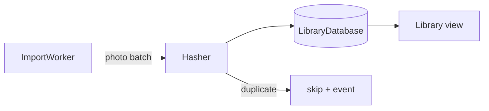
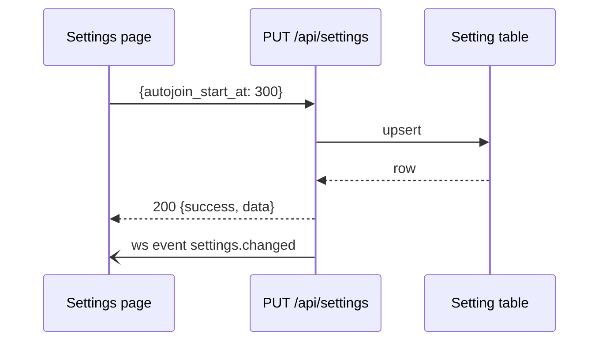
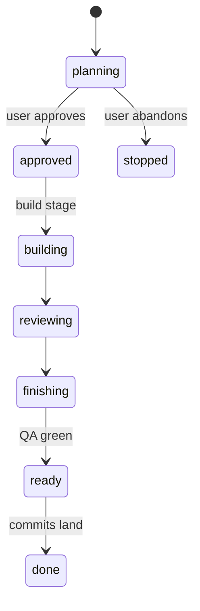
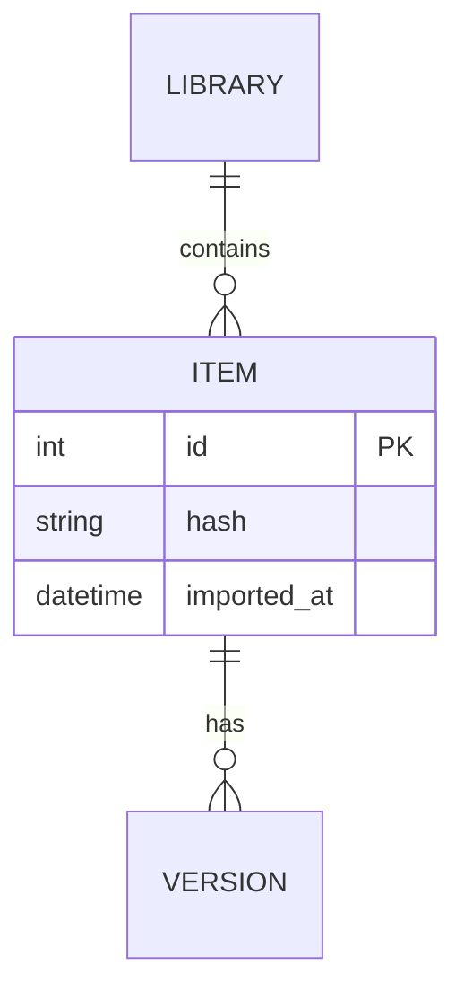

# Writing documentation

A document is for a reader who was not there: a contributor who never spoke to the
author, or the user approving a plan. Everything below serves that reader. Truth to the
code comes first; presentation is what makes the truth findable.

## Structure

- Lead with what the reader needs to decide or do; background comes after. The first
  paragraph of any document or section answers "what is this and why does it matter".
- One idea per paragraph, three to six sentences. A section longer than a screen gets a
  subsection or a table.
- Headings are nouns naming the content ("Import pipeline", "Settings keys"), not
  questions or process narration ("What we did").
- Name real things: file paths, functions, endpoints, settings keys, defaults, exit codes.
  A claim a reader can check against the code is worth three that sound right.
- No marketing, no diff summaries, no "round 3" or ticket numbers in a document that
  describes the system; the log of how a change was made belongs in the plan document's
  Log, not in the architecture doc.
- In a project that does not use Diátaxis (`docs.diataxis` is `false` or absent), and in
  every section a change does not touch, keep the document's existing structure and
  tone when editing it; add presentation to the sections you touch, do not reformat
  sections the change did not reach. A project that uses Diátaxis places and moves text
  as the Diátaxis section below says.

## When to use what

| Use | For |
|---|---|
| Prose | the "why", trade-offs, anything with nuance |
| Bullet list | three or more parallel items that are each one or two sentences |
| Numbered list | steps that happen in order |
| Table | comparisons, options with consequences, fields and their meaning, commands and what they do, anything a reader scans by row |
| Code block | commands, paths, config snippets, request and response examples, error text; never inline more than one identifier per sentence |
| Checklist (`- [ ]`) | acceptance criteria and steps with a status |
| Diagram | relationships, flows, sequences or states that prose would need more than a paragraph to convey |

## When a diagram earns its place

Draw one when the reader must hold more than three things and their relationships in
mind at once: a pipeline with branches, a request crossing components, a lifecycle with
more than three states, a data model with relations. Do not draw one for a linear
two-step process, a list, or to decorate. A document rarely needs more than one diagram
per section. Every diagram has a one-sentence caption under it saying what to look at.

Rules for every diagram:

- One idea per diagram; at most about twelve nodes. Split or zoom rather than crowd.
- Node and edge labels use the names in the code (module, class, endpoint, event, state)
  so the reader can grep for them.
- Edges are labelled when the relationship is not obvious ("emits", "reads", "HTTP POST").
- The diagram is true to the code at the commit it describes. In audit mode a stale box or
  edge is a finding like a stale sentence.
- Mermaid, in a fenced ```` ```mermaid ```` block. GitHub, GitLab and most renderers draw
  it; the source stays readable and diffable.

## Mermaid patterns

Flow of data or control, pipelines, module dependencies: `flowchart`. `LR` for pipelines
and dependencies, `TD` for hierarchies and decision trees.



A request or an interaction across components, services or threads: `sequenceDiagram`.
Participants are the real modules; messages are the real calls or events.



A lifecycle: `stateDiagram-v2`. States are the real enum values or statuses; transitions
carry the trigger.



A data model with relations: `erDiagram`. Entities are tables or models, with their key
fields; cardinality on the edges.



Class or type relationships, only when inheritance or composition is the point:
`classDiagram`, kept to the classes the section discusses.

Decision trees (triage, routing): `flowchart TD` with diamond nodes `{"question?"}` and
labelled `-->|yes|` / `-->|no|` edges.

## Mermaid syntax that bites

- Quote labels that contain parentheses, brackets, colons, pipes or quotes:
  `node["GET /api/x (list)"]`; an unquoted `(` or `[` changes the node shape or breaks
  the parse.
- Node ids are letters, digits and underscores; put the readable name in the label.
- `%%` starts a comment; `#` does not.
- No HTML, no Markdown inside labels; `<br/>` works for a line break in most renderers.
- Subgraphs: `subgraph name ["Readable title"] … end`; edges across subgraphs are fine.
- `-->` solid, `-.->` dotted (optional or async), `==>` thick (the main path). In sequence
  diagrams `->>` is a call, `-->>` a return, `-)` an async message.
- Keep one diagram under about 25 lines; renderers truncate or shrink large ones.

## Document kinds

| Document | Opens with | Must contain |
|---|---|---|
| README | what it is, who it is for, install, first run | features, configuration, development commands, where the other docs are |
| Functional spec | the problem and who has it | goals, non-goals, acceptance criteria, decisions with consequences |
| Technical spec / architecture | the model in one paragraph and one diagram | components and their responsibilities, data flow, data model, boundaries, migration, risks |
| How-to | the outcome in one sentence | numbered steps with the exact commands, what success looks like, what to do when it fails |
| Reference (API, settings, CLI) | one table or list per family | every item, its type or shape, default, and effect; same format for every entry |
| Decision record | the question in one sentence | options with consequences, the choice, why, what it rules out |

The plan document (`templates/plan.md`) is an analysis (request, current state,
constraints, unknowns) followed by a functional spec and a technical spec. Current state
lives in the Analysis, not in the technical spec. Current state and Proposed model get a
diagram when the change touches more than two parts or a flow; the Contracts section gets
a sequence diagram when two components talk; Decisions are a table or a list with one
consequence per option.

## Diátaxis

A project whose profile sets `docs.diataxis` to `true` sorts its documentation by what
the reader needs, in four kinds, each in a directory of its own. The user chose this for
the project; nothing here applies when the key is `false` or absent.

| Kind | The reader needs | The document contains | It leaves out | Directory |
|---|---|---|---|---|
| Tutorial | to learn by doing, as a newcomer | one guided lesson from a clean start to a result that always works, every step and command given, what the reader should see after each | choices, alternatives, background, every option | `tutorials/` |
| How-to guide | to reach a goal they already have | the goal in one sentence, the steps in order with the exact commands, what success looks like, what to do when it fails | teaching the basics, the why, a full list of options | `how-to/` |
| Reference | to look up a fact while working | every item of one family (setting, command, endpoint, field, event) in the same format: name, type or shape, default, effect | steps, opinions, the why | `reference/` |
| Explanation | to understand why | the design, its reasons and trade-offs, the history, how the parts fit, a diagram when the pack calls for one | steps to follow, the full list of items | `explanation/` |

To tell which kind a text is, ask two questions: is the reader learning or working, and
do they need to do something or to know something?

| | Do | Know |
|---|---|---|
| Learning | tutorial | explanation |
| Working | how-to guide | reference |

A text that answers both ways is two texts: split it, put each part in its directory, and
link them to each other. Signs that settle most cases: numbered steps toward a goal the
reader brings are a how-to guide; a lesson with a fixed, safe example is a tutorial; a
table with one row per item is reference; "because", "instead of", "trade-off" and
diagrams of how parts fit are explanation.

The existing "Document kinds" map onto the four as follows. A README is none of them: it
stays where it is as the entry point and links to the index of each of the four
directories; small-step rule 4 names the sections it keeps. A how-to goes in `how-to/`. A reference (API,
settings, CLI) goes in `reference/`. A technical spec or architecture document is
explanation; its tables of fields or commands are reference and go there. A functional spec
kept as project documentation and a decision record are explanation. A plan document is none
of the four: it stays in the plans directory and is never filed or moved.

**Where the directories sit.** Under the first directory listed in `docs.paths`, that is
the first entry that ends with `/` and is not the plans directory (`docs.plans`), which is
ignored by git and never holds documentation, or under `docs/` when no such entry exists:
`<that directory>/tutorials/`, `how-to/`, `reference/`, `explanation/`. An entry without
the trailing `/` is not a directory here, even when one of that name exists: the scope gate
reads it as a single file, so nothing written under it is in scope. When the user answers
yes for a project whose `docs.paths` has no entry ending with `/`, the lead or
`/conclave:init` adds `docs/` to it in the same write, so the directories are yours to
create. When they are outside `docs.paths` all the same (the entry was removed later), you
may not create them: write as a project without Diátaxis does and say under `gaps` that a
directory must be added to `docs.paths`.

**Small steps.** The documentation moves into the four directories as tasks touch it,
never in one pass:

1. New text goes into the directory of its kind: into the file there on the same subject,
   or a new file named after the subject in lowercase kebab-case.
2. A directory that does not exist yet is created with a short index file (`README.md`, or
   `index.md` when the project's other directories use that name) holding a heading, one
   sentence saying what belongs there, and a list of its files. Add every new file to its
   directory's index, and link a new index from the README when the README is in
   `docs.paths` (under `gaps` when it is not).
3. A section of an older document outside the four directories moves only when this change
   makes you edit it. The section is the smallest one that holds the edit: from the deepest
   heading above the edited text to the next heading of any level (the edited paragraphs
   alone when no heading comes before them). Move that section, with your edit, to the file
   of its kind; its parent and sibling sections stay where they are. In its old place keep
   the heading and replace its body with one line that points to the new place
   (`Moved to [Title](relative/path.md#anchor).`). A parent section whose content is now
   only such pointer lines, its subsections' included, is listed under `gaps`.
4. Move nothing else. Sections you did not have to edit stay where they are, even when they
   belong elsewhere; list those in the documents you edited under `gaps`, one line each with
   the kind they belong to. Never move text out of a file you may not edit, the plans
   directory, the roadmap named by `docs.roadmap`, a changelog, or the README's entry-point
   sections: what the project is and who it is for, a short feature list, install, first
   run, and the links to the four indexes. Edit those in place. Every other README section
   (configuration, development commands, architecture, a long feature reference) is an
   older section like any other and follows rule 3.
5. After a move, search the repository for links to the old file and its anchors. Update
   the ones inside `docs.paths`; list every other one under `gaps` with file and line, for
   whoever owns that file.

In audit mode, in a project that uses Diátaxis, text placed in the directory of the wrong
kind is a finding: quote it and name the kind and directory it belongs to.
